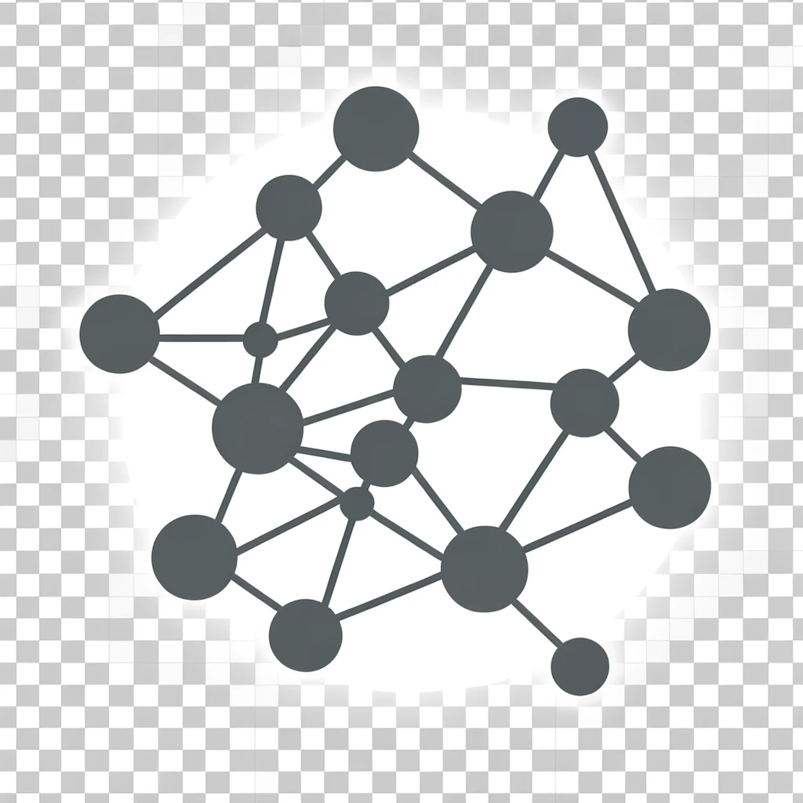

# Willkommen zu AlgoDat Docs

Dies ist ein Projekt von Maximilian Hoelper, Wirtschaftsinformatikstudent der Universität Mannheim.

## Features:
- Erklärung der Algorithmen
- Simulatoren mit eigener Eingabe
- Graphische Darstellungen
- Laufzeitberechnungen

### Ausprobieren. Visualisieren. Verstehen.

Die Docs sind ein Nachschlagewerk mit Simulator der Algorithmen des Inhaltes der Vorlesung Algorithmen und Datenstrukturen an der Universität Mannheim.

## Algorithmen
